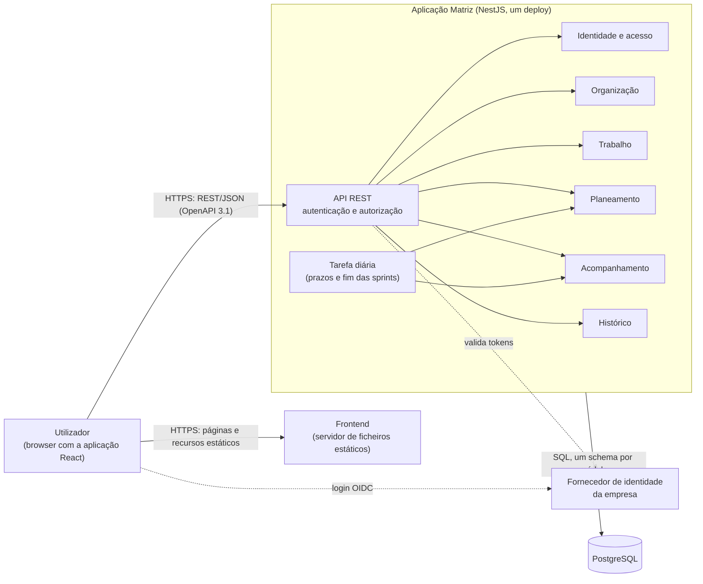
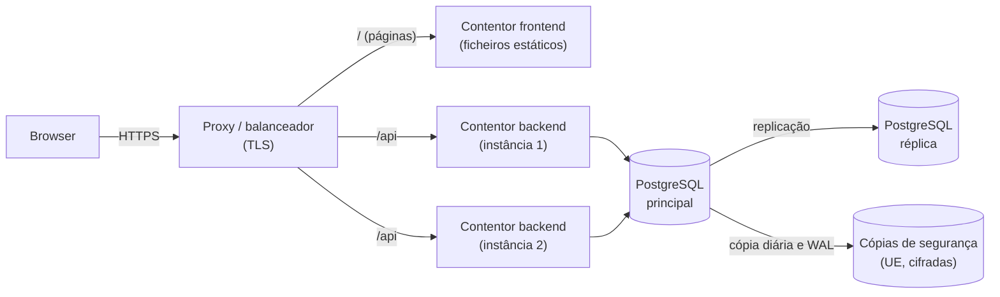

# Matriz — Arquitetura

> **Versão:** 0.2 · **Data:** 2026-10-29 · **Estado:** revisto na revisão cruzada (Ficha PL 02, Ex. 5)
> **Relacionados:** [`requirements.md`](requirements.md) · [`constraints.md`](constraints.md) · [`database.md`](database.md) · [`../openapi.yaml`](../openapi.yaml)

Este documento descreve a arquitetura do MVP. As decisões técnicas (DT) estão registadas em [`constraints.md`](constraints.md) §4; os requisitos prevalecem sobre este documento.

---

## 1. Contexto

A Matriz é uma aplicação interna (RN16) de gestão de projetos e tarefas, com regras de negócio ricas — ciclo de vida (RN26), capacidade (RN06, RN22), permissões (`requirements.md` §3.1) e histórico inalterável (RN32, SEC04) — e uma escala pequena:

| Requisito | Valor |
|---|---|
| Utilizadores (RNF06) | 100 iniciais, todos em simultâneo; até 500 sem alterações de arquitetura |
| Desempenho (RNF08) | ≤ 2 s em 95 % das operações |
| Disponibilidade (RNF09) | 99 % em horário de trabalho |
| Equipa de desenvolvimento | Uma |

### 1.1 Características determinantes

| # | Característica | Porquê |
|---|---|---|
| 1 | **Consistência e auditabilidade dos dados** | Várias operações alteram vários dados de uma só vez e têm de ficar registadas: a transferência de uma tarefa move as subtarefas e escreve o histórico (RN20, RN22, RN32); um alerta nasce com o evento que o origina (DT07). |
| 2 | **Simplicidade e rapidez de entrega** | MVP, uma só equipa, prazos de uma unidade curricular. |
| 3 | **Evolutividade** | Fronteiras de domínio claras, para evoluir o produto e, se necessário, extrair serviços (DT10). |

Não são determinantes: elasticidade, escalabilidade além de RNF06 e deploy independente de partes da aplicação.

## 2. Comparação de estilos

| | Monólito em camadas | **Monólito modular** | Microservices |
|---|---|---|---|
| Descrição | Uma aplicação, organizada por camadas técnicas (controladores, serviços, repositórios). | Uma aplicação, organizada por módulos de domínio com fronteiras explícitas, cada um dono dos seus dados. | Vários serviços independentes, cada um com a sua base de dados, comunicando pela rede. |
| Consistência e auditabilidade | Transações locais simples. | Transações locais simples, mesmo entre módulos. | Operações entre serviços exigem consistência eventual (sagas, outbox). |
| Simplicidade | A mais simples no início. | Simples: um deploy, uma base de dados. | A mais complexa: rede, observabilidade distribuída, vários deploys. |
| Evolutividade | Fraca: as regras de um domínio espalham-se por todas as camadas. | Boa: cada domínio evolui no seu módulo; um módulo pode ser extraído mais tarde. | A melhor para muitas equipas independentes. |
| Custo operacional | Baixo. | Baixo. | Alto para uma equipa. |
| Adequação ao MVP | Aceitável a curto prazo, mas tende a degradar-se. | **Adequada.** | Desproporcionada para 500 utilizadores e uma equipa. |

## 3. Decisão — ADR-001: monólito modular

**Contexto.** MVP interno, uma equipa de desenvolvimento, até 500 utilizadores (RNF06), com regras que alteram vários dados de forma atómica (RN20, RN22, RN32) e histórico inalterável (SEC04).

**Opções.** A — monólito em camadas; B — monólito modular; C — microservices.

**Decisão.** **B — monólito modular** (DT03), com:

- uma API REST/JSON documentada em OpenAPI 3.1 e comunicação síncrona com o cliente web;
- seis módulos de domínio (§5), cada um dono das suas tabelas, num schema próprio da mesma base de dados PostgreSQL (DT02);
- comunicação entre módulos dentro do processo, por interfaces públicas e eventos de domínio internos (§6).

**Porquê.** Cumpre as três características: transações locais entre módulos (1), um único deploy e uma única base de dados (2) e fronteiras de domínio que permitem evoluir ou extrair módulos (3). A opção A perde em evolutividade; a C paga o custo da distribuição — rede, consistência eventual, operação — sem nenhum dos seus benefícios a esta escala.

**O que se aceita perder.** Escalar ou fazer deploy de cada módulo em separado; isolamento de falhas entre módulos (uma falha grave afeta toda a aplicação).

**Consequências.**
- As fronteiras entre módulos têm de ser protegidas por convenção e por testes de arquitetura (§9), porque o processo e a base de dados são partilhados.
- As transações que hoje abrangem vários módulos terão de ser redesenhadas (p. ex. com outbox) se um módulo for extraído.
- A aplicação não guarda estado em memória entre pedidos, para poder correr em várias instâncias.

**Rever quando** se verificarem os sinais da DT10 ([`constraints.md`](constraints.md) §4.2): várias equipas com entregas independentes, módulos com necessidades de carga ou disponibilidade muito diferentes, ou crescimento para milhares de utilizadores em que várias instâncias do monólito deixem de cumprir RNF08 e RNF09. O número de utilizadores, por si só, não obriga à migração.

**Reversibilidade.** Decisão difícil de reverter (*one-way door*), mitigada pelas fronteiras de módulo.

### 3.1 Tecnologias

| Área | Escolha | DT |
|---|---|---|
| Linguagem | TypeScript em toda a aplicação | DT01 |
| Backend | NestJS — os módulos do NestJS correspondem aos módulos de domínio | DT01 |
| Frontend | React, aplicação web para computador, em pt-PT, WCAG 2.1 AA | DT01, DT05, RNF10–RNF12 |
| Base de dados | PostgreSQL, um schema por módulo | DT02 |
| Autenticação | OpenID Connect com o fornecedor de identidade da empresa | DT04 |
| Alojamento | Contentores — uma imagem para o frontend e outra para o backend —, em infraestrutura interna ou numa região cloud da UE | DT06 |

As bibliotecas concretas (ORM, validação, testes) são escolhidas na Aula 03 e acrescentadas apenas com aprovação (`AGENTS.md` §2).

## 4. Vista geral

## 5. Componentes e responsabilidades

| Módulo | Responsabilidades | Dados de que é dono | Regras | US |
|---|---|---|---|---|
| **Identidade e acesso** | Autenticação OIDC; contas de utilizador; papel de administrador; avaliação da matriz de permissões em cada operação, consultando o módulo Organização para os papéis por equipa e por projeto. | Utilizadores, papel global | SEC01, SEC02, §3.1 | Transversal |
| **Organização** | Equipas (criação, nome, desativação, líderes); pertenças a equipas com papel e alocação; projetos e respetivos gestores; associação de equipas a projetos. | Equipas, pertenças, projetos, gestores, associações equipa–projeto | RN06 (alocação), RN21, RN23, RN25, RN33, RN34 | US01 |
| **Trabalho** | Hierarquia (objetivos, épicos, tarefas, subtarefas); campos e prazos; estimativas; atribuição; ciclo de vida e transições; critérios de aceitação; bloqueios; transferências entre equipas. | Elementos da hierarquia, critérios de aceitação, bloqueios | RN02, RN03, RN07, RN10–RN13, RN17, RN20, RN22, RN24, RN26–RN29 | US02, US03, US06, US09 |
| **Planeamento** | Sprints (criação, datas, início manual e fim automático); backlog; planear, acrescentar e retirar tarefas de sprints, incluindo a saída das tarefas transferidas; capacidade, ajustes de disponibilidade e deteção de sobrecarga; estimativa no início da sprint. | Sprints, planeamento tarefa–sprint, ajustes de disponibilidade, estimativas no início da sprint | RN01, RN04–RN06, RN19, RN20 (saída da sprint), RN22 (capacidade), RN27, RN31, RN36, RN37 | US04, US05, US08 |
| **Acompanhamento** | Geração e consulta de alertas; verificação diária de prazos; progresso e desvios por equipa e por sprint. | Alertas | RN09, RN18, RN19, RN30 | US07 |
| **Histórico** | Registo só de acrescento de todas as alterações relevantes; consulta do histórico de cada elemento; aplicação da política de retenção. | Eventos de histórico | RN14, RN15, RN32, SEC03, SEC04, SEC09 | US06, US09, transversal |

## 6. Interação entre módulos

- **Interfaces públicas.** Cada módulo expõe uma interface (serviços de aplicação) aos restantes. Nenhum módulo lê ou escreve as tabelas de outro.
- **Dependências num só sentido.** Planeamento → Trabalho → Organização; Identidade e acesso → Organização. Não há dependências circulares.
- **Eventos de domínio internos.** Os módulos Trabalho, Planeamento e Organização publicam eventos (p. ex. *tarefa transferida*, *tarefa bloqueada*, *sobrecarga detetada*). Acompanhamento e Histórico subscrevem-nos; o Planeamento subscreve *tarefa transferida*, para retirar a tarefa e as subtarefas da sprint da equipa de origem (RN20, RN22). Os eventos são entregues **dentro do processo e na mesma transação** do pedido, o que garante que uma alteração nunca fica gravada sem o respetivo histórico e alerta (DT07, SEC03), e evita que o Trabalho dependa do Acompanhamento e do Planeamento.
- **Transações.** Cada pedido é uma transação na base de dados, mesmo quando envolve vários módulos.
- **Camadas dentro de cada módulo.** API (controladores e DTO) → aplicação (casos de uso) → domínio (entidades e regras) ← infraestrutura (repositórios). As regras de negócio ficam no domínio e não nos controladores nem em SQL.
- **Evolução planeada (DT11).** A gestão de eventos interna é suficiente para o MVP. Fica por estudar a sua melhoria e, para deployments integrados em larga escala, a adoção de uma plataforma de eventos (p. ex. Kafka). Esse passo acompanha a extração de módulos (DT10): eventos entre serviços deixam de poder ser entregues na mesma transação e passam a exigir, por exemplo, o padrão outbox e consumidores idempotentes.

## 7. Preocupações transversais

| Tema | Abordagem | Requisitos |
|---|---|---|
| Autenticação | Tokens OIDC validados em cada pedido; sem sessão em memória. | SEC01, CAT01, DT04 |
| Autorização | Verificada no backend em cada operação, segundo a matriz de permissões; uma operação recusada não altera dados. | SEC02, SEC07, CAT02, CAT05, CAT06 |
| Histórico e auditoria | Módulo Histórico, alimentado por eventos na mesma transação; sem operações de edição ou remoção. | SEC03, SEC04, RN32, CAT03, CAT04 |
| Alertas | Guardados na base de dados; o frontend consulta-os periodicamente; prazos verificados por uma tarefa diária, executada por uma única instância. | RN18, RN30, DT07 |
| Fim das sprints | A mesma tarefa diária termina as sprints ativas cuja data de fim já passou e devolve ao backlog as tarefas não concluídas. | RN04, RN36 |
| Erros da API | Formato único de erro (*problem details*, RFC 9457) com o código HTTP adequado. Suficiente para o MVP; a gestão de erros será melhorada no futuro (DT12). | Ex. 3, DT12 |
| Validação | Dados de entrada validados na fronteira da API. | RN07, RN29, RN31, RN33 |
| Privacidade | Minimização de dados; motivos pessoais nunca registados; retenção segundo SEC09. | SEC05, SEC06, SEC09, P12 |
| Observabilidade | Logs estruturados com identificador de pedido; métricas de tempo de resposta para verificar RNF08; medição da disponibilidade em horário de trabalho para verificar RNF09. | RNF08, RNF09 |
| Cópias de segurança e recuperação | Cópia base diária e arquivo contínuo das alterações (WAL) do PostgreSQL, na UE e cifrados; reposição num momento anterior a um erro; testes de reposição periódicos. Uma réplica não substitui as cópias, porque replica também os erros. | RNF13, DT13 |
| Interface | pt-PT, para computador, WCAG 2.1 AA. | RNF10–RNF12 |
| Testes | Um teste automático por CA ao nível da API; testes de arquitetura que verificam as dependências entre módulos. | DT08 |

## 8. Implantação

- **Duas imagens de contentor:** frontend (ficheiros estáticos servidos por um servidor web) e backend (API). Cada uma é versionada, atualizada e reiniciada sem afetar a outra, e o frontend continua disponível — podendo informar o utilizador — se a API falhar.
- **Mesma origem:** o proxy encaminha `/api` para o backend e o resto para o frontend, o que evita configurar CORS.
- **Duas instâncias do backend** (DT13), sem estado, atrás do balanceador, com verificações de saúde e reinício automático. Uma falha de uma instância ou de uma máquina não interrompe o serviço, e as correções urgentes publicam-se uma instância de cada vez.
- **PostgreSQL com réplica e cópias de segurança** (DT13, RNF13: RPO 5 min, RTO 1 h), na infraestrutura interna ou numa região cloud da UE (DT06, P09). Numa cloud, PostgreSQL gerido com mudança automática para a réplica; em infraestrutura interna, mudança manual segundo um procedimento escrito.
- A tarefa diária (prazos e fim das sprints) corre numa única instância de cada vez: antes de começar, obtém um trinco no PostgreSQL (*advisory lock*), sem dependências novas.
- **Limitação conhecida:** o proxy/balanceador e a mudança manual para a réplica (em infraestrutura interna) são pontos a vigiar; se a disponibilidade medida se aproximar de 99 %, passa-se a um cluster com mudança automática (DT13).

## 9. Riscos e mitigação

| Risco | Mitigação |
|---|---|
| Com processo e base de dados partilhados, um módulo acede às tabelas de outro e as fronteiras degradam-se. | Um schema por módulo; testes de arquitetura que falham perante dependências proibidas. |
| Crescimento das tabelas de alertas e de histórico. | Revisão planeada (DT09); retenção segundo SEC09. |
| Dependências npm (risco na cadeia de fornecimento, atualizações). | Versões fixadas num lockfile; dependências novas só com aprovação (`AGENTS.md` §2). |
| Uma falha grave do backend afeta todas as funcionalidades. | Frontend e backend em imagens separadas; duas instâncias do backend e réplica da base de dados (DT13); extração de módulos segundo DT10. |
| A gestão de eventos interna não serve para deployments distribuídos em larga escala. | Estudo da melhoria da gestão de eventos e de uma plataforma de eventos (DT11), em conjunto com DT10. |
| A gestão de erros é básica (formato único, sem catálogo nem monitorização dedicada). | Melhoria planeada (DT12). |
| Perda de dados por falha da base de dados ou erro humano. | Réplica e cópias de segurança com reposição num momento anterior; testes de reposição (DT13, RNF13). |
| Política de retenção não validada juridicamente. | P12 — validação por um encarregado de proteção de dados antes da produção. |

## 10. Pressupostos e decisões pendentes

- **Pressupostos em aberto** que afetam a arquitetura: P09 (RGPD) e P12 (retenção). Ver [`constraints.md`](constraints.md) §2.
- **Revisões futuras** ([`constraints.md`](constraints.md) §4.2): DT09 (alertas na base de dados), DT10 (extração de módulos), DT11 (gestão de eventos e plataforma de eventos) e DT12 (gestão de erros).
- Não há decisões funcionais ou técnicas pendentes que bloqueiem esta arquitetura.
