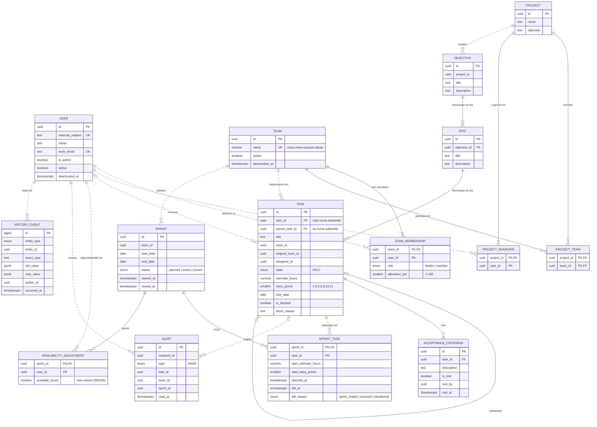

# Matriz — Modelo de dados

> **Versão:** 0.2 · **Data:** 2026-10-29 · **Estado:** revisto na revisão cruzada (Ficha PL 02, Ex. 5)
> **Relacionados:** [`requirements.md`](requirements.md) · [`architecture.md`](architecture.md) · [`constraints.md`](constraints.md)

Modelo lógico dos dados essenciais do MVP, para PostgreSQL (DT02). Os requisitos prevalecem sobre este documento; o que estiver marcado **por confirmar** não deve ser implementado sem decisão (`AGENTS.md` §2).

---

## 1. Convenções

- **Identificadores** em inglês (tabelas e colunas em `snake_case`); descrições em pt-PT.
- **Chaves primárias** `id` do tipo `uuid`, exceto nas tabelas de associação, que usam chave composta, e no histórico, que usa `bigint` sequencial.
- **Datas e horas** em `timestamptz` (UTC); datas de calendário em `date`.
- **Um schema por módulo** ([`architecture.md`](architecture.md) §5): `identity`, `organization`, `work`, `planning`, `tracking`, `history`.
- **Referências entre módulos são lógicas:** guardam o identificador, mas sem chave estrangeira na base de dados; a existência é validada pelo módulo dono, através da sua interface. Dentro de um módulo usam-se chaves estrangeiras reais. Isto mantém as fronteiras da ADR-001 e permite extrair módulos mais tarde (DT10). No diagrama, as referências lógicas aparecem a tracejado.

## 2. Entidades

### 2.1 Identidade e acesso (`identity`)

**user** — colaborador interno com acesso à aplicação (SEC01, SEC05).

| Atributo | Tipo | Chave | Regra |
|---|---|---|---|
| id | uuid | PK | |
| external_subject | text | UK, nulo | Identificador do utilizador no fornecedor de identidade (OIDC, DT04); preenchido no primeiro acesso (RN35). |
| name | text | | Obrigatório. Mantém-se no histórico após a saída (RN15, SEC09). |
| work_email | text | UK | Contacto profissional (SEC05). |
| is_admin | boolean | | Papel global de administrador (§3.1). |
| active | boolean | | Conta desativada quando o colaborador sai (SEC09). |
| deactivated_at | timestamptz | nulo | Início do prazo de 12 meses para apagar os restantes dados pessoais (SEC09). |
| created_at | timestamptz | | |

### 2.2 Organização (`organization`)

**team** — equipa (RN01, RN33, RN34).

| Atributo | Tipo | Chave | Regra |
|---|---|---|---|
| id | uuid | PK | |
| name | varchar(100) | UK parcial | Obrigatório; único entre equipas ativas, sem distinguir maiúsculas (RN33). |
| active | boolean | | Só desativável sem tarefas por concluir (RN33). |
| deactivated_at | timestamptz | nulo | |
| created_at | timestamptz | | |

**team_membership** — pertença de um utilizador a uma equipa (RN06, RN21, RN34).

| Atributo | Tipo | Chave | Regra |
|---|---|---|---|
| team_id | uuid | PK, FK → team | |
| user_id | uuid | PK, ref. lógica → user | |
| role | enum (`leader`, `member`) | | Papel por equipa (§3.1). Uma equipa ativa tem pelo menos um `leader` (RN34). Líderes e membros contam para a capacidade (RN06). |
| allocation_pct | smallint | | 1–100. A soma das alocações de um utilizador é 100 (RN06). |
| created_at | timestamptz | | |

**project** — projeto (RF02, RN25).

| Atributo | Tipo | Chave | Regra |
|---|---|---|---|
| id | uuid | PK | |
| name | text | | Obrigatório. |
| objective | text | | Objetivo do projeto (RF02). |
| created_at | timestamptz | | |

**project_manager** — gestor de um projeto; quem cria o projeto passa a ser gestor (§3.1).

| Atributo | Tipo | Chave | Regra |
|---|---|---|---|
| project_id | uuid | PK, FK → project | |
| user_id | uuid | PK, ref. lógica → user | |

**project_team** — participação de uma equipa num projeto (RF03, RN23; relação N:M confirmada, P06).

| Atributo | Tipo | Chave | Regra |
|---|---|---|---|
| project_id | uuid | PK, FK → project | Sem duplicados (CA01.5). Um projeto pode não ter equipas (RN33). |
| team_id | uuid | PK, FK → team | |

### 2.3 Trabalho (`work`)

**objective** — nível de topo da hierarquia de um projeto; um único nível (RN12, RN23).

| Atributo | Tipo | Chave | Regra |
|---|---|---|---|
| id | uuid | PK | |
| project_id | uuid | ref. lógica → project | |
| title | text | | Obrigatório. |
| description | text | | |
| created_at | timestamptz | | |

**epic** — épico de um objetivo (RN12).

| Atributo | Tipo | Chave | Regra |
|---|---|---|---|
| id | uuid | PK | |
| objective_id | uuid | FK → objective | O projeto é herdado do objetivo (RN23). |
| title | text | | Obrigatório. |
| description | text | | |
| created_at | timestamptz | | |

**task** — tarefa ou subtarefa (RN12, RN22, RN29).

| Atributo | Tipo | Chave | Regra |
|---|---|---|---|
| id | uuid | PK | |
| epic_id | uuid | FK → epic, nulo | Obrigatório numa tarefa (RN12); nulo numa subtarefa. |
| parent_task_id | uuid | FK → task, nulo | Preenchido só numa subtarefa. Uma subtarefa não tem subtarefas (RN12). Exatamente um de `epic_id` e `parent_task_id` está preenchido. |
| title | text | | Obrigatório (RN29). |
| description | text | | Opcional. Texto livre: sem motivos pessoais (SEC06). |
| team_id | uuid | ref. lógica → team | Obrigatório (RN29); equipa associada ao projeto (RN23); numa subtarefa, igual à da tarefa principal (RN22). |
| original_team_id | uuid | ref. lógica → team | Equipa na criação; nunca muda (RN14). |
| assignee_id | uuid | ref. lógica → user, nulo | Responsável pela execução (RN15). |
| state | enum (RN17) | | `in_planning`, `in_technical_analysis`, `ready_for_development`, `in_development`, `in_testing`, `done`, `delivered`. Transições: RN26. |
| estimate_hours | numeric(6,2) | nulo | ≥ 0. Numa tarefa com subtarefas, a soma das subtarefas é calculada e não guardada (RN22). |
| story_points | smallint | nulo | 1, 2, 3, 5, 8, 13 ou 21 (RN07). |
| due_date | date | nulo | Prazo opcional (RN29). |
| is_blocked | boolean | | Indicador independente do estado (RN28). |
| block_reason | text | nulo | Obrigatório quando `is_blocked` (RN28); sem motivos pessoais (SEC06). |
| created_by | uuid | ref. lógica → user | |
| created_at | timestamptz | | |

**acceptance_criterion** — critério de aceitação de uma tarefa (RN13, RN24, RN27).

| Atributo | Tipo | Chave | Regra |
|---|---|---|---|
| id | uuid | PK | |
| task_id | uuid | FK → task | |
| description | text | | Obrigatório. Alterações após «A desenvolver» só por líder ou gestor (RN24). |
| is_met | boolean | | «Terminada» só com todos cumpridos (RN13). |
| met_by | uuid | ref. lógica → user, nulo | |
| met_at | timestamptz | nulo | |
| created_by | uuid | ref. lógica → user | |
| created_at | timestamptz | | |

### 2.4 Planeamento (`planning`)

**sprint** — período de trabalho de uma equipa (RN01, RN31, RN36).

| Atributo | Tipo | Chave | Regra |
|---|---|---|---|
| id | uuid | PK | |
| team_id | uuid | ref. lógica → team | |
| start_date | date | | ≤ `end_date` (RN31). Alterável só enquanto `planned` e no início (RN36). |
| end_date | date | | Sem sobreposição com outras sprints da equipa (RN31). |
| status | enum (`planned`, `active`, `closed`) | | No máximo uma sprint `active` por equipa (RN31). Início manual; fim automático no fim da data de fim (RN36). |
| started_at | timestamptz | nulo | Preenchido no início (RN36). |
| closed_at | timestamptz | nulo | Preenchido no fim (RN36). |
| created_at | timestamptz | | |

**sprint_task** — planeamento de uma tarefa numa sprint (RN04, RN05, RN10, RN20, RN27, RN37). Retirar uma tarefa de uma sprint `planned` remove a linha; a remoção fica no histórico.

| Atributo | Tipo | Chave | Regra |
|---|---|---|---|
| sprint_id | uuid | PK, FK → sprint | |
| task_id | uuid | PK, ref. lógica → task | Só tarefas com estimativa temporal (RN27). Cada tarefa está, no máximo, numa sprint em aberto. |
| planned_at | timestamptz | | Posterior a `sprint.started_at` numa tarefa acrescentada depois do início (RN37). |
| start_estimate_hours | numeric(6,2) | nulo | Estimativa no início da sprint ou, numa tarefa acrescentada depois do início, no momento em que entra; para comparação (RN10, RN37, RF27). |
| start_story_points | smallint | nulo | Idem. |
| left_at | timestamptz | nulo | Preenchido quando a tarefa sai de uma sprint `active`: não concluída no fim da sprint (RN04), retirada pelo líder (RN37) ou transferida para outra equipa (RN20). As concluídas ficam associadas à sprint. As retiradas continuam a contar como planeadas no início (RF27). |
| left_reason | enum (`sprint_ended`, `removed`, `transferred`) | nulo | Motivo da saída; preenchido com `left_at`. |

**availability_adjustment** — horas disponíveis de um membro numa sprint, quando diferentes do cálculo de RN06 (CA05.5).

| Atributo | Tipo | Chave | Regra |
|---|---|---|---|
| sprint_id | uuid | PK, FK → sprint | |
| user_id | uuid | PK, ref. lógica → user | |
| available_hours | numeric(6,2) | | ≥ 0. **Sem coluna de motivo** (SEC06). |
| updated_by | uuid | ref. lógica → user | |
| updated_at | timestamptz | | |

A capacidade não é guardada: calcula-se como 8 h × dias úteis da sprint × `allocation_pct`, ou a partir do ajuste, quando existe (RN06).

### 2.5 Acompanhamento (`tracking`)

**alert** — alerta na aplicação (RN18, RN19, RN30).

| Atributo | Tipo | Chave | Regra |
|---|---|---|---|
| id | uuid | PK | |
| recipient_id | uuid | ref. lógica → user | Só o destinatário o vê (SEC07). |
| type | enum | | `deadline_passed`, `task_blocked`, `task_reopened`, `member_task_created`, `team_overload`, `individual_overload` (RN09, RN19, RN30). |
| task_id | uuid | ref. lógica → task, nulo | |
| team_id | uuid | ref. lógica → team, nulo | Nas sobrecargas. |
| sprint_id | uuid | ref. lógica → sprint, nulo | Nas sobrecargas. |
| created_at | timestamptz | | |
| read_at | timestamptz | nulo | |

O volume desta tabela será revisto (DT09).

### 2.6 Histórico (`history`)

**history_event** — registo só de acrescento (RN32, SEC03, SEC04).

| Atributo | Tipo | Chave | Regra |
|---|---|---|---|
| id | bigint | PK | Sequencial; dá a ordem cronológica. |
| entity_type | enum | | `team`, `project`, `objective`, `epic`, `task`, `acceptance_criterion`, `sprint`, `team_membership`. |
| entity_id | uuid | ref. lógica | Elemento a que o evento diz respeito. |
| event_type | text | | P. ex. `state_changed`, `assignee_changed`, `team_transferred`, `estimate_changed`, `criterion_changed`, `due_date_changed`, `correction` (SEC09). |
| old_value | jsonb | nulo | Valor anterior. |
| new_value | jsonb | nulo | Valor novo; inclui a justificação nas atribuições a outra equipa (RN03). |
| author_id | uuid | ref. lógica → user | |
| occurred_at | timestamptz | | |

Sem `UPDATE` nem `DELETE` para a aplicação (SEC04); as retificações são novos eventos `correction` (SEC09).

## 3. Relacionamentos e cardinalidades

| Relação | Cardinalidade | Regra |
|---|---|---|
| Equipa — pertença — utilizador | Equipa 1 : N pertenças (pelo menos um líder se ativa); utilizador 1 : N pertenças (pelo menos uma se for membro) | RN21, RN34 |
| Projeto — equipa | N : M (via `project_team`); um projeto pode ter 0 equipas | P06 (confirmado), RN33 |
| Projeto — gestor | Projeto 1 : N gestores (pelo menos um); utilizador 0 : N projetos geridos | §3.1 |
| Projeto — objetivo | 1 : N | RN23 |
| Objetivo — épico | 1 : N | RN12 |
| Épico — tarefa | 1 : N; cada tarefa tem exatamente um épico | RN12 |
| Tarefa — subtarefa | 1 : N; uma subtarefa tem exatamente uma tarefa principal | RN22 |
| Tarefa — critério de aceitação | 1 : N (0 enquanto a tarefa não estiver pronta) | RN27 |
| Equipa — tarefa (responsável) | 1 : N; cada tarefa tem exatamente uma equipa | RN02 |
| Utilizador — tarefa (responsável pela execução) | 0..1 : N | RN15, RN29 |
| Equipa — sprint | 1 : N | RN01 |
| Sprint — tarefa | N : M (via `sprint_task`), com no máximo uma sprint em aberto por tarefa | RN04, RN05 |
| Sprint — ajuste de disponibilidade — utilizador | Sprint 1 : N ajustes; no máximo um por utilizador e sprint | RN06 |
| Utilizador — alerta | 1 : N | RN30 |
| Elemento — evento de histórico | 1 : N | RN32 |

## 4. Diagrama ER

Linhas contínuas: chaves estrangeiras dentro de um módulo. Linhas a tracejado: referências lógicas entre módulos (§1).

## 5. Regras de integridade

| Regra | Onde é garantida |
|---|---|
| Nome de equipa único entre equipas ativas, sem distinguir maiúsculas (RN33) | Base de dados: índice único parcial sobre `lower(name)` onde `active` |
| Story points na escala fixa (RN07); alocação entre 1 e 100 (RN06); horas ≥ 0 | Base de dados: restrições `CHECK` |
| Tarefa com exatamente um de `epic_id` / `parent_task_id`; subtarefa sem subtarefas (RN12, RN22) | Base de dados (`CHECK`) e aplicação |
| Início da sprint ≤ fim; sem sobreposição; no máximo uma sprint ativa por equipa (RN31) | Base de dados: `CHECK`, restrição de exclusão sobre o intervalo de datas e índice único parcial |
| Datas da sprint alteráveis só enquanto `planned` (RN36) | Aplicação |
| `block_reason` obrigatório quando bloqueada (RN28) | Base de dados (`CHECK`) e aplicação |
| Histórico sem alterações nem remoções (SEC04) | Base de dados: permissões (só `INSERT` e `SELECT`) |
| Uma tarefa em no máximo uma sprint em aberto (RN04, RN05; o estado da sprint está noutra tabela); soma das alocações = 100 (RN06); pelo menos um líder por equipa ativa (RN34); equipa da subtarefa igual à da principal (RN22); equipa associada ao projeto (RN23); transições (RN26); critérios e estimativa para planear (RN27); alterações de critérios e estimativas (RN10, RN24); justificação (RN03); tarefas concluídas não transferíveis (RN20) | Aplicação (camada de domínio), porque envolvem várias linhas ou módulos |
| Existência de entidades referenciadas entre módulos | Aplicação, através da interface do módulo dono (§1) |

## 6. Pressupostos e pontos por confirmar

| # | Ponto | Estado |
|---|---|---|
| 1 | Equipas e projetos em relação N:M (`project_team`). | Confirmado — P06. |
| 2 | O líder de equipa conta para a capacidade da equipa. | Confirmado — RN06 (D33). |
| 3 | Criação de contas: o administrador regista o utilizador pelo e-mail profissional e a ligação ao fornecedor de identidade (`external_subject`) faz-se no primeiro acesso. | Confirmado — RN35 (D34). |
| 4 | Referências lógicas, sem chave estrangeira, entre módulos (§1). | Decisão de modelação desta proposta, decorrente da ADR-001. |
| 5 | Volume das tabelas `alert` e `history_event`. | Revisão futura: DT09; retenção segundo SEC09 (validação jurídica: P12). |
| 6 | Ciclo de vida da sprint e saída de tarefas a meio da sprint (`started_at`, `closed_at`, `left_at`, `left_reason`). | Confirmado — RN20, RN36, RN37 (D35–D40). |
