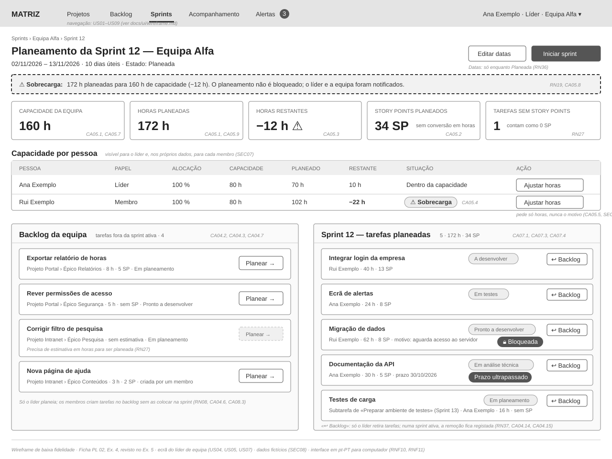

# Matriz — Wireframe: planeamento da sprint

> **Versão:** 0.2 · **Data:** 2026-10-29 · **Estado:** revisto na revisão cruzada (Ficha PL 02, Ex. 5)
> **Ficheiro:** [`wireframe.svg`](wireframe.svg) — abrir no browser; se for necessário um PNG, exportar a partir do browser.
> **Relacionados:** [`../user-stories.md`](../user-stories.md) · [`../architecture.md`](../architecture.md) · [`../../openapi.yaml`](../../openapi.yaml)

Wireframe de baixa fidelidade do ecrã de **planeamento e capacidade de uma sprint**, visto pelo **líder de equipa**. Foi escolhido por representar o problema central do MVP: planear o trabalho de cada equipa com visibilidade sobre a capacidade (OBJ04, US04, US05). Todos os dados são fictícios (SEC08).

## 1. Navegação

| Entrada | Funcionalidade do MVP | Notas |
|---|---|---|
| Projetos | Gerir projetos e a hierarquia de trabalho (US01, US02) | Mostra só os projetos visíveis ao utilizador (§3.1, CAT06). |
| Backlog | Backlog das equipas e criação de tarefas (US03, US04, US08) | |
| Sprints | Sprints e capacidade (US04, US05) — **ecrã deste wireframe** | |
| Acompanhamento | Progresso, desvios e tarefas atrasadas ou bloqueadas (US07) | |
| Alertas (contador) | Alertas na aplicação (RN18, RN30) | Só os do próprio utilizador (SEC07). |
| Menu do utilizador | Identificação, papel e equipa | A administração (contas, equipas — US01, RN35) aparece só ao administrador e não está neste ecrã. |

As atribuições e transferências entre equipas (US09) fazem-se a partir do detalhe da tarefa, que não faz parte deste wireframe.

## 2. Elementos e validação face ao MVP

| Elemento | Requisitos | Validação |
|---|---|---|
| Cabeçalho da sprint: datas, dias úteis, estado | US04 · CA04.1, RN31, RN36 | Coerente: a sprint está «Planeada». |
| «Editar datas» | RN36 · CA04.12, CA04.13 | Coerente: só enquanto a sprint está «Planeada»; depois do início, o botão não aparece. |
| «Iniciar sprint», com confirmação ou ajuste das datas | RN05, RN36 · CA04.5, CA04.9–CA04.11 | Coerente: disponível ao líder e ao administrador, não ao gestor de projeto nem ao membro. |
| Aviso de sobrecarga, sem bloqueio | RN19 · CA05.3, CA05.8 | Coerente: o planeamento continua possível e a notificação é indicada. |
| Indicadores: capacidade, horas planeadas, horas restantes | RN06 · CA05.1, CA05.7, CA05.9 | Coerente com `GET /sprints/{sprintId}/capacity` (`capacityHours`, `plannedHours`, `remainingHours`). |
| Story points planeados, separados das horas; tarefas sem story points | RN06, RN27 · CA05.2 | Coerente: nunca são convertidos nem somados às horas. |
| Tabela de capacidade por pessoa (alocação, capacidade, planeado, restante, sobrecarga) | RN06, RN19 · CA05.4, CA05.6, CA05.10, CA05.11 | Coerente com `members` da API. O líder conta para a capacidade (RN06). |
| «Ajustar horas» | CA05.5 · SEC06 | Pede apenas horas, nunca o motivo. |
| Backlog: tarefas fora da sprint ativa, com projeto, épico, estimativas e estado | Glossário · CA04.2, CA04.3 | Coerente: o backlog mostra tarefas de vários projetos da equipa (P06). |
| «Planear →» inativo numa tarefa sem estimativa temporal | RN27 · CA04.7 | Coerente. |
| Tarefa criada por um membro, visível no backlog | RN08, RN09 · CA08.1 | Coerente; só o líder a pode planear (CA04.6, CA08.3). |
| Tarefas da sprint com estado, responsável, horas e story points | RN17, RN26 · CA07.1 | Coerente. |
| Indicador «Bloqueada», com motivo, ao lado do estado | RN28 · CA07.4, CA07.6 | Coerente: o bloqueio não substitui o estado. O motivo descreve o impedimento (SEC06). |
| Indicador «Prazo ultrapassado» | RN29, RN30 · CA07.3, CA07.7 | Coerente. |
| Subtarefa planeada numa sprint diferente da tarefa principal | RN22 · CA05.9 | Coerente: só as horas da subtarefa contam nesta sprint. |
| «↩ Backlog» em cada tarefa da sprint | RN37 · CA04.6, CA04.14, CA04.15 | Coerente: só o líder retira tarefas. Numa sprint ativa, o mesmo ecrã permite acrescentar tarefas do backlog (CA04.16). |

Totais do exemplo, para conferir: 40 + 24 + 62 + 30 + 16 = 172 h planeadas; 13 + 8 + 8 + 5 = 34 SP (uma tarefa sem SP); capacidade 80 + 80 = 160 h; Ana 24 + 30 + 16 = 70 h; Rui 40 + 62 = 102 h.

## 3. Ações decididas na revisão cruzada (Ex. 5)

A primeira versão do wireframe incluía três ações que nenhum requisito definia. Foram retiradas (`AGENTS.md` §2), decididas pelo humano na revisão cruzada ([`../review.md`](../review.md) §3) e repostas:

| Ação | Decisão |
|---|---|
| «Iniciar sprint» | Início manual, pelo líder de equipa ou pelo administrador (D36, RN36). |
| «Editar datas» de uma sprint | Enquanto a sprint está «Planeada» e no momento do início; depois, não (D37, RN36). |
| «↩ Backlog» — retirar uma tarefa da sprint | Permitido ao líder; numa sprint ativa fica registado e continua a contar como planeado no início (D38, RN37). |

## 4. Fora deste wireframe

- Outros ecrãs: projetos e hierarquia, detalhe da tarefa (critérios de aceitação, histórico, transferência), acompanhamento, alertas e administração.
- Versão para dispositivos móveis: fora do MVP (RNF11).
- Acessibilidade (RNF12, WCAG 2.1 AA) e contraste: a verificar no protótipo de alta fidelidade e na implementação; o wireframe usa apenas tons de cinzento e texto, sem depender da cor.
